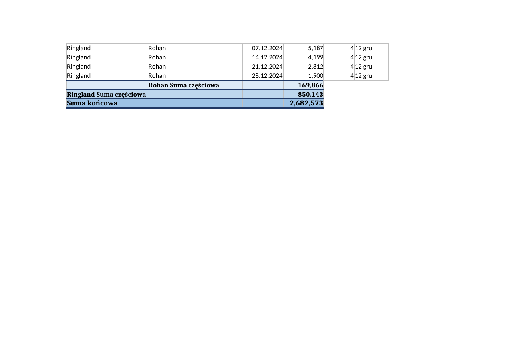
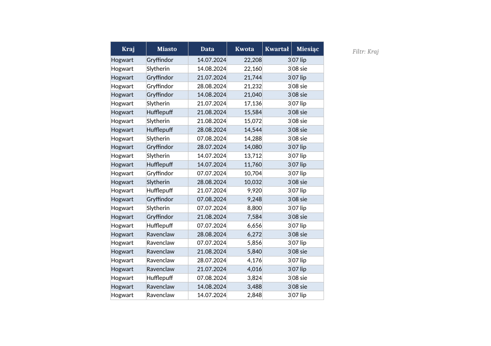
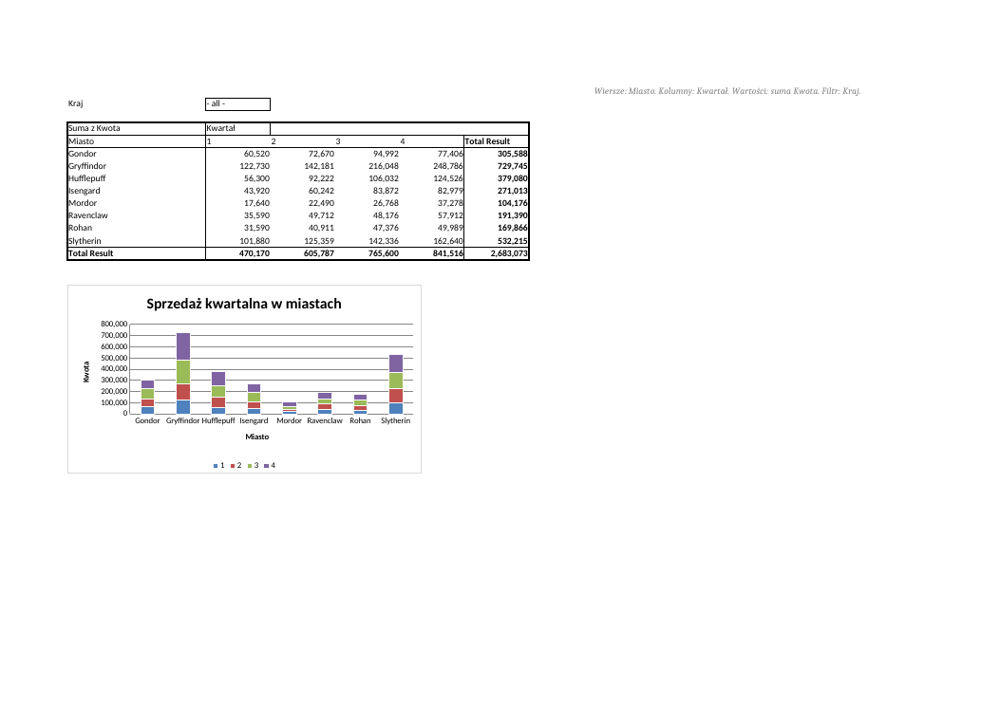
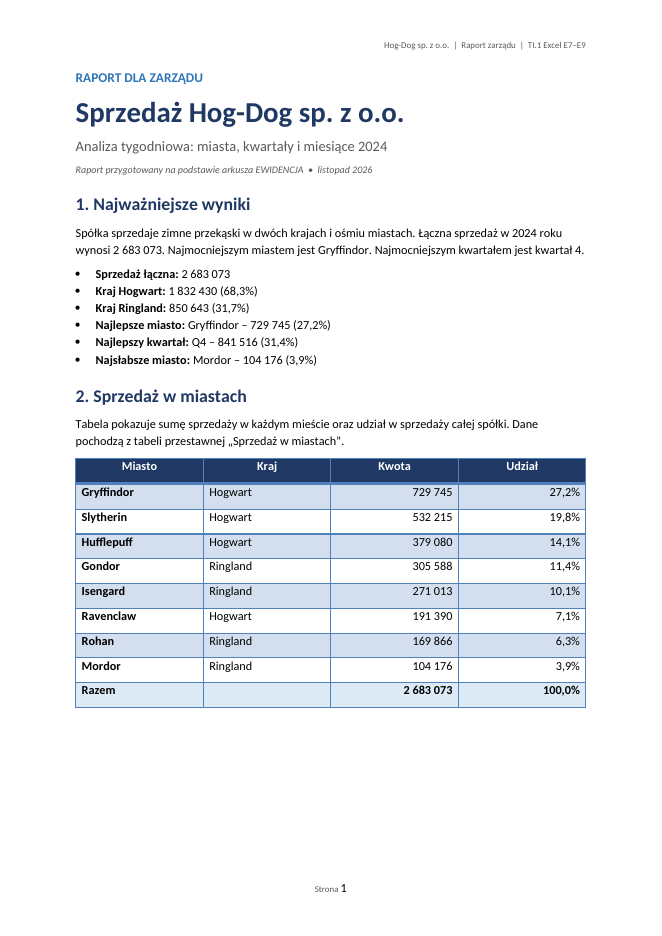

# TI.1 – Excel: zadania E7, E8 i E9

Część III laboratorium z przedmiotu **Technologie Informacyjne**.
Zakres: organizowanie danych w tabele, tabele i wykresy przestawne oraz osadzanie obiektów w programie Word.

Wszystkie zadania z pliku PDF są wykonane.
Gotowy skoroszyt to [`TI.1_Excel.E7+E8+E9_PlikRoboczy.xlsx`](./TI.1_Excel.E7+E8+E9_PlikRoboczy.xlsx).
Raport Word to [`RAPORT-E9-Hog-Dog.docx`](./RAPORT-E9-Hog-Dog.docx).
Dokładna instrukcja klikania jest w pliku [`INSTRUKCJA-KROK-PO-KROKU.md`](./INSTRUKCJA-KROK-PO-KROKU.md).

---

## 1. Pliki w katalogu

| Plik | Zawartość |
| --- | --- |
| [`TI.1_Excel.E7+E8+E9_InstrukcjaLab.pdf`](./TI.1_Excel.E7+E8+E9_InstrukcjaLab.pdf) | Oryginalna treść poleceń E7, E8 i E9. |
| [`TI.1_Excel.E7+E8+E9_PlikRoboczy.xlsx`](./TI.1_Excel.E7+E8+E9_PlikRoboczy.xlsx) | Ukończony skoroszyt: 10 arkuszy, 2 tabele, 7 tabel przestawnych, 2 wykresy przestawne. |
| [`RAPORT-E9-Hog-Dog.docx`](./RAPORT-E9-Hog-Dog.docx) | Raport dla zarządu. Zawiera tekst, tabelę wyników, dwa wykresy i opis metod osadzania obiektów. |
| [`README.md`](./README.md) | Ten dokument. Wyjaśnia pojęcia, wyniki i odpowiedzi na pytania. |
| [`INSTRUKCJA-KROK-PO-KROKU.md`](./INSTRUKCJA-KROK-PO-KROKU.md) | Instrukcja wykonania każdego polecenia krok po kroku. |

---

## 2. Co zawiera skoroszyt

| Arkusz | Rola |
| --- | --- |
| `EWIDENCJA` | Dane źródłowe. Tabela `SprzedażTygodniowa`, czerwona karta, kolumny `Kwartał` i `Miesiąc`. |
| `KONSPEKT` | Kopia arkusza EWIDENCJA z sortowaniem i sumami częściowymi. |
| `PRZEFILTROWANE` | Kopia arkusza EWIDENCJA posortowana po kwocie i przefiltrowana. |
| `Sprzedaż w miastach` | Tabela przestawna: miasta w wierszach, suma kwoty, filtr Kraj. |
| `Kwartalnie w miastach` | Tabela przestawna: kwartał i miasto w wierszach, suma oraz udział procentowy. |
| `Miasta kwartałami` | Tabela przestawna: kraj, miasto i kwartał w wierszach, układ konspektu. |
| `Tabelarycznie` | Tabela przestawna: miasta w wierszach, kwartały w kolumnach. Wykres przestawny. |
| `Miasta w miesiącach` | Tabela przestawna: miesiące w wierszach, kraje i miasta w kolumnach. |
| `Cwiczenia` | Dodatkowa tabela przestawna do pokazania „przestawności”. |
| `WykresPrzestawny` | Drugi wykres przestawny. Powstał z danych arkusza EWIDENCJA. |

---

## 3. Najważniejsze liczby

Dane w arkuszu `EWIDENCJA` mają **385 rekordów**.
To 384 wiersze z pliku źródłowego i jeden wiersz dodany w zadaniu 2f.

| Pozycja | Wartość |
| --- | ---: |
| Sprzedaż łączna | **2 683 073** |
| Kraj Hogwart | 1 832 430 (68,3%) |
| Kraj Ringland | 850 643 (31,7%) |
| Kwartał 1 | 470 170 |
| Kwartał 2 | 605 787 |
| Kwartał 3 | 765 600 |
| Kwartał 4 | 841 516 |
| Najlepsze miasto: Gryffindor | 729 745 (27,2%) |
| Najsłabsze miasto: Mordor | 104 176 (3,9%) |
| Filtr Hogwart, 01.07–31.08.2024 | **333 584** (32 wiersze) |

> **Ważna różnica.** Arkusz `KONSPEKT` powstał **przed** dodaniem wiersza z 31.12.2024.
> Dlatego ma 384 rekordy i sumę **2 682 573**.
> Arkusze `EWIDENCJA`, `PRZEFILTROWANE` i tabele przestawne mają 385 rekordów i sumę **2 683 073**.
> Różnica wynosi 500. To kwota dodanego wiersza Ringland / Isengard.

---

## 4. Temat E7 – organizowanie danych w tabele

### 4.1. Konspekt i sumy częściowe

Arkusz `KONSPEKT` to kopia arkusza `EWIDENCJA` bez wiersza z 31.12.2024.
Dane są posortowane trzema poziomami:

1. `Kraj`,
2. `Miasto`,
3. `Data`.

Dzięki sortowaniu każdy kraj i każde miasto tworzą jeden spójny blok.
Nie ma powtórzonych krajów ani miast. To warunek poprawnego konspektu.

W arkuszu są dwa poziomy sum częściowych:

| Poziom | Wiersz podsumowania | Przykład |
| --- | --- | --- |
| 3 | szczegóły | pojedyncze tygodnie |
| 2 | suma miasta | `Gryffindor Suma częściowa` = 729 745 |
| 1 | suma kraju | `Hogwart Suma częściowa` = 1 832 430 |
| 0 | suma końcowa | **2 682 573** |

Sumy miast: Gryffindor 729 745, Hufflepuff 379 080, Ravenclaw 191 390, Slytherin 532 215.
Sumy krajów: Hogwart 1 832 430, Ringland 850 143.

Po lewej stronie okna działają przyciski `1`, `2`, `3` oraz `+` i `−`.
Poziom 1 pokazuje tylko kraje. Poziom 2 pokazuje kraje i miasta. Poziom 3 pokazuje wszystkie szczegóły.

### 4.2. Formuły czy wartości

W komórkach sum częściowych są **formuły**, nie wartości.
Excel wstawia funkcję `SUMA.CZĘŚCIOWA` (`SUBTOTAL`).
Przykład: `=SUMA.CZĘŚCIOWA(9;D2:D49)`.

Skutek: zmiana kwoty w dowolnym wierszu zmienia sumę miasta, sumę kraju i sumę końcową.
Polecenie 1e każe zmienić wartość z 28.12. Po zmianie suma się zmienia.
To dowód, że podsumowania są dynamiczne.

### 4.3. Tabela SprzedażTygodniowa

Arkusz `EWIDENCJA` ma czerwony kolor karty.
Zakres `A1:F386` jest tabelą o nazwie `SprzedażTygodniowa`.

| Kolumna | Znaczenie |
| --- | --- |
| `Kraj` | kraj sprzedaży |
| `Miasto` | miasto sprzedaży |
| `Data` | data tygodnia |
| `Kwota` | wartość sprzedaży |
| `Kwartał` | numer kwartału, formuła `=ZAOKR.GÓRA(MIESIĄC(C2)/3;0)` |
| `Miesiąc` | miesiąc w formacie `01 sty`, kolumna pomocnicza |

Tabela ma styl `TableStyleMedium9` i włączone paski wierszy.
Kolumna `Kwartał` powstała przez rozszerzenie tabeli.
Kolumna `Miesiąc` to jawna kolumna pomocnicza. Zastępuje automatyczne grupowanie dat w tabeli przestawnej.
Dzięki niej raport miesięczny działa w Excelu i w LibreOffice.

W zadaniu 2f do tabeli dodano wiersz:

| Kraj | Miasto | Data | Kwota | Kwartał | Miesiąc |
| --- | --- | --- | ---: | ---: | --- |
| Ringland | Isengard | 31.12.2024 | 500 | 4 | 12 gru |

Kolumna `G` ( `Średnia dzienna` ) jest poza tabelą.
Pokazuje przykład `=D2/7`. Wskazówka w pliku źródłowym opisuje, jak Excel zamienia taką formułę na odwołanie strukturalne, gdy komórka należy do tabeli.

### 4.4. Szybkie sortowanie i filtrowanie

Arkusz `PRZEFILTROWANE` to kopia arkusza `EWIDENCJA` po dodaniu wiersza 31.12.2024.

Wykonane czynności:

1. Sortowanie po kolumnie `Kwota` malejąco.
2. Filtr `Kraj = Hogwart`.
3. Filtr `Data` od 01.07.2024 do 31.08.2024.
4. Wiersz sumy z sumowaniem tylko kolumny `Kwota`.

Widoczne są **32 wiersze**. Suma wynosi **333 584**.

Wiersz sumy używa formuły `=SUMA.CZĘŚCIOWA(109;SprzedażTygodniowa_Filtr[Kwota])`.
Funkcja `109` sumuje tylko widoczne wiersze.
Dlatego suma wynosi 333 584, a nie 2 683 073.
Kolumna `Kwartał` nie jest sumowana. W komórce sumy jest pusty wynik.

### 4.5. Odpowiedzi na pytania z tematu E7

**Czy w komórkach podsumowania są formuły czy wartości?**
Są formuły `SUMA.CZĘŚCIOWA`. Zmiana danych zmienia wynik.

**Czy po zmianie wartości z 28.12 suma się zmienia?**
Tak. Zmienia się suma miasta, suma kraju i suma końcowa.

**Dlaczego kraje i miasta nie mogą się powtarzać?**
Konspekt grupuje kolejne wiersze. Powtórzony kraj tworzy drugą grupę. Wtedy przyciski rozwijania działają źle.

**Co sumuje wiersz sumy po filtrze?**
Tylko widoczne wiersze. Nie sumuje ukrytych wierszy ani całej kolumny.

---

## 5. Temat E8 – tabele i wykresy przestawne

### 5.1. Raporty przestawne

| Arkusz | Wiersze | Kolumny | Filtr | Układ | Wartości |
| --- | --- | --- | --- | --- | --- |
| `Sprzedaż w miastach` | Miasto | – | Kraj | kompaktowy | suma Kwota |
| `Kwartalnie w miastach` | Kwartał, Miasto | Wartości | Kraj | konspekt | suma Kwota + % całości |
| `Miasta kwartałami` | Kraj, Miasto, Kwartał | – | – | konspekt | suma Kwota |
| `Tabelarycznie` | Miasto | Kwartał | Kraj | tabelaryczny | suma Kwota |
| `Miasta w miesiącach` | Miesiąc | Kraj, Miasto | – | tabelaryczny | suma Kwota |
| `Cwiczenia` | Kraj | Miasto | Kwartał | tabelaryczny | suma Kwota |
| `WykresPrzestawny` | Miasto | – | – | kompaktowy | suma Kwota |

Raport `Kwartalnie w miastach` ma dwa pola wartości:

* `Suma z Kwota`,
* `% z całości`.

W Excelu te kolumny stoją obok siebie. Druga kolumna pokazuje udział w sprzedaży całej spółki.
Suma udziałów wynosi 100,00%.

### 5.2. Wykresy przestawne

**Wykres 1** leży w arkuszu `Tabelarycznie`.
To wykres kolumnowy skumulowany.
Pokazuje sprzedaż każdego miasta w czterech kwartałach.
Źródłem jest tabela przestawna `PTTabelarycznie`.

**Wykres 2** leży w arkuszu `WykresPrzestawny`.
To wykres słupkowy sprzedaży według miast.
Powstał przez `Wstawianie / Tabele / Tabela przestawna / Wykres przestawny` na nowym arkuszu.

### 5.3. Odpowiedzi na pytania z tematu E8

**Czy komórki tabeli przestawnej zawierają formuły?**
Nie. Zawierają obliczone wartości. Excel pokazuje je jako wynik, nie jako formułę.

**Czy tabela przestawna aktualizuje się sama po zmianie danych?**
Nie. Po zmianie danych w arkuszu `EWIDENCJA` trzeba kliknąć `Analiza / Odśwież`.
Plik ma włączone odświeżanie przy otwarciu. Dzięki temu po ponownym otwarciu raport jest aktualny.
W trakcie pracy zmiana danych nie odświeża raportu automatycznie.

**Czy wykres przestawny można przestawiać i filtrować?**
Tak. Wykres ma przyciski pól. Można zmieniać układ, filtr i poziom zagregowania.
Zmiana wykresu zmienia tabelę pod wykresem. Oba elementy korzystają z jednego źródła.

**Dlaczego w raporcie miesięcznym jest kolumna `Miesiąc`, a nie grupowanie dat?**
Grupowanie dat w pliku XLSX jest trudne do przeniesienia między programami.
Kolumna `Miesiąc` daje ten sam wynik: 12 wierszy miesięcy i sumy w podziale na miasta.
Dane źródłowe nadal mają pełną datę w kolumnie `Data`.

---

## 6. Temat E9 – osadzanie obiektów w dokumencie Word

### 6.1. Raport

Plik [`RAPORT-E9-Hog-Dog.docx`](./RAPORT-E9-Hog-Dog.docx) zawiera:

* tekst dla zarządu,
* tabelę sprzedaży w miastach,
* dwa wykresy: sprzedaż według miast i sprzedaż kwartalna,
* opis metod osadzania obiektów,
* tabelę porównania metod,
* wnioski.

### 6.2. Osadzanie a łączenie

| Metoda | Co powstaje | Zachowanie |
| --- | --- | --- |
| `Wklej` | tabela Worda albo obraz | Brak połączenia z Excelem. |
| `Wklej specjalnie / Arkusz programu Excel – obiekt` | obiekt OLE, kopia | Dwuklik otwiera Excel. Zmiany dotyczą tylko kopii. |
| `Wklej łącze` | obiekt OLE, łącze | Dwuklik otwiera Excel. Zmiany idą do pliku źródłowego. |
| `Wstaw / Obiekt / Utwórz nowy` | nowy obiekt OLE | Edycja w miejscu lub w Excelu. |
| `Wstaw / Obiekt / Z pliku` | obiekt OLE z pliku | Można wybrać osadzenie albo łącze. |

Obiekt **osadzony** jest niezależną kopią. Zmiana w Wordzie nie zmienia pliku źródłowego.
Obiekt **połączony** trzyma ścieżkę do pliku. Zmiana w Excelu aktualizuje obiekt w Wordzie.
Połączenie przestaje działać, gdy plik źródłowy zmieni miejsce.

### 6.3. Odpowiedzi na pytania z tematu E9

**Co się dzieje po dwukrotnym kliknięciu obiektu arkusza?**
Word pokazuje wstążkę Excela. Można edytować komórki bez opuszczania dokumentu.

**Jaka jest różnica między `Wstaw / Wykres` a `Wstaw / Obiekt / Wykres`?**
`Wstaw / Wykres` tworzy wykres Worda. Dane są w dokumencie Word.
`Wstaw / Obiekt / Wykres` tworzy obiekt OLE. Dwuklik otwiera Excel.

**Czy `Wstaw / Tabela / Arkusz kalkulacyjny programu Excel` daje inny obiekt niż `Wstaw / Obiekt`?**
Nie. To ten sam typ obiektu OLE. Różni się tylko przycisk na wstążce.

**Ile plików powstaje po zapisie?**
Jeden plik `.docx`. Osadzone skoroszyty są w środku pliku, w katalogu `word/embeddings`.

**Czy zmiana w obiekcie osadzonym zmienia arkusz źródłowy?**
Nie. Obiekt osadzony jest kopią.

**Czy zmiana w obiekcie połączonym zmienia arkusz źródłowy?**
Tak. Łącze pokazuje ten sam plik. Zmiana działa w obie strony.

**Jakie są inne metody wstawiania obiektów?**
`Wstaw / Obiekt / Utwórz z pliku`, przeciągnięcie pliku do dokumentu, `Wklej specjalnie` z wybranym formatem.
Obiekty OLE można też wstawiać do arkusza Excela.

---

## 7. Jak sprawdzić gotowy plik

1. Otwórz `TI.1_Excel.E7+E8+E9_PlikRoboczy.xlsx`. Excel nie powinien pokazać komunikatu o naprawie.
2. Sprawdź, że są 10 arkuszy.
3. Sprawdź czerwoną kartę arkusza `EWIDENCJA`.
4. Sprawdź tabelę `SprzedażTygodniowa` i zakres `A1:F386`.
5. Wejdź w `KONSPEKT`. Kliknij przyciski `1`, `2`, `3`. Sprawdź sumy.
6. Sprawdź, że suma końcowa w `KONSPEKT` wynosi **2 682 573**.
7. Wejdź w `PRZEFILTROWANE`. Sprawdź 32 widoczne wiersze i sumę **333 584**.
8. Otwórz każdy arkusz przestawny. Sprawdź wartości i filtr `Kraj`.
9. Sprawdź, że `Tabelarycznie` ma wykres kolumnowy skumulowany.
10. Sprawdź, że `WykresPrzestawny` ma wykres słupkowy.
11. Otwórz `RAPORT-E9-Hog-Dog.docx`. Sprawdź tabelę i dwa wykresy.
12. Kliknij dwukrotnie tabelę przestawną w raporcie. Sprawdź, czy otwiera się Excel.

---

## 8. Uwagi techniczne

* Formuły w pliku są zapisane po angielsku, bo tak wygląda format XLSX.
  Excel pokazuje je po polsku.
* Tabele przestawne mają włączone odświeżanie przy otwarciu.
  Dzięki temu Excel sam uzupełnia układ po otwarciu pliku.
* Wykresy przestawne mają powiązanie z tabelami przestawnymi przez `pivotSource`.
* Kolumna `Miesiąc` jest świadomym rozwiązaniem zastępującym grupowanie dat.
  Opisuje to punkt 5.3.
* Wszystkie liczby w dokumentacji są zgodne z plikiem.

---

## 9. Powiązane pliki

* [Instrukcja krok po kroku](./INSTRUKCJA-KROK-PO-KROKU.md)
* [Skoroszyt](./TI.1_Excel.E7+E8+E9_PlikRoboczy.xlsx)
* [Raport Word](./RAPORT-E9-Hog-Dog.docx)
* [Treść poleceń PDF](./TI.1_Excel.E7+E8+E9_InstrukcjaLab.pdf)
